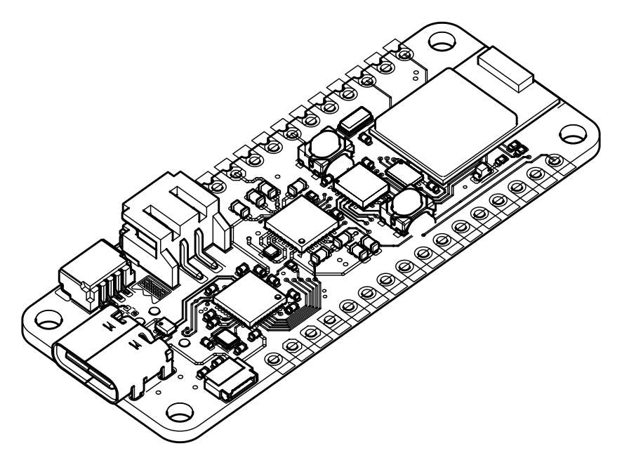

# KiRend

KiRend renders a KiCad 10 board (`.kicad_pcb`) and its 3D models as black line art on a white
background, in the style of assembly instructions. Output is SVG or PNG. The camera options are
the same as `kicad-cli pcb render`, and the image is framed exactly like kicad-cli's, so the two
can be overlaid.



*KiCad's `royalblue54L_feather` demo board rendered by KiRend in isometric view. The board design is
from the [KiCad demos](https://gitlab.com/kicad/code/kicad/-/tree/master/demos) (CC BY-SA 4.0);
this image is likewise licensed under CC BY-SA 4.0.*

```
kirend [options] INPUT_FILE
kirend -o board.svg --rotate '-45,0,45' --layers Edge.Cuts,F.Cu,F.SilkS my_board.kicad_pcb
```

Run `kirend --help` for all options. See [docs/DESIGN.md](docs/DESIGN.md) for how it works.

> **AI disclaimer:** The code, tests and documentation in this repository were generated by an AI
> model (Anthropic's Claude), working from requirements and decisions given by the project owner.
> The code has not been fully reviewed line by line by a human. Check the results before relying
> on them.

## Download

Prebuilt binaries for Windows (x64), Linux (x64, arm64) and macOS (Apple Silicon) are attached to
each [GitHub Release](https://github.com/hin/KiRend/releases). Each is a single standalone file
with no runtime libraries to install. The Linux binary needs glibc 2.35 or newer (Ubuntu 22.04,
Debian 12 or later); the macOS binary needs macOS 15 or newer.

The macOS binary is not signed. After downloading it with a browser, remove the quarantine flag
once: `xattr -d com.apple.quarantine kirend`.

Releases are built by GitHub Actions (`.github/workflows/build.yml`) when a version tag is pushed:

```sh
git tag v0.1.0
git push origin v0.1.0
```

## Building

KiRend is built with CMake and [vcpkg](https://github.com/microsoft/vcpkg), which downloads and
builds all dependencies. The first build compiles OpenCASCADE and takes 20 to 40 minutes; later
builds reuse vcpkg's binary cache. Requirements: CMake 3.21 or newer, a C++20 compiler and Git.
Each platform has a CMake preset (`macos`, `linux`, `windows`, `msys2`); the build goes to
`build/<preset>`.

If a configure failed because `VCPKG_ROOT`, Ninja or a compiler was missing, delete
`build/<preset>` before trying again.

### macOS

```sh
xcode-select --install            # C++ compiler, if not installed yet
brew install cmake ninja pkg-config

git clone https://github.com/microsoft/vcpkg.git ~/vcpkg
~/vcpkg/bootstrap-vcpkg.sh
echo 'export VCPKG_ROOT=$HOME/vcpkg' >> ~/.zshrc
export VCPKG_ROOT=$HOME/vcpkg

cmake --preset macos
cmake --build --preset macos
ctest --preset macos
```

The binary is `build/macos/kirend`.

### Linux

Tested on Ubuntu 24.04 with GCC 13; GCC 11 or newer works. On Debian or Ubuntu:

```sh
sudo apt-get install build-essential git curl zip unzip tar pkg-config cmake ninja-build \
    libgl1-mesa-dev libegl-dev       # OpenGL headers, needed to build OpenCASCADE

git clone https://github.com/microsoft/vcpkg.git ~/vcpkg
~/vcpkg/bootstrap-vcpkg.sh
echo 'export VCPKG_ROOT=$HOME/vcpkg' >> ~/.bashrc
export VCPKG_ROOT=$HOME/vcpkg

cmake --preset linux
cmake --build --preset linux
ctest --preset linux
```

On other distributions, install the same tools and the OpenGL/EGL development packages. If
CMake is older than 3.21, install a newer one (for example with `pip install cmake`). The binary
is `build/linux/kirend`.

### Windows with Visual Studio

Install [Visual Studio 2022](https://visualstudio.microsoft.com/) (Community is enough) with the
**Desktop development with C++** workload, which includes CMake, and
[Git for Windows](https://git-scm.com/download/win). Then, in a **Developer PowerShell for
VS 2022**:

```powershell
git clone https://github.com/microsoft/vcpkg.git C:\vcpkg
C:\vcpkg\bootstrap-vcpkg.bat
setx VCPKG_ROOT C:\vcpkg               # for new terminals
$env:VCPKG_ROOT = "C:\vcpkg"           # for this terminal

cmake --preset windows
cmake --build --preset windows
ctest --preset windows
```

The `windows` preset uses the Visual Studio generator and the `x64-windows-static` triplet, and
links the C/C++ runtime statically too, so `kirend.exe` runs without extra DLLs or the VC++
redistributable. If you built with this preset before, delete `build\windows` first. The binary
is `build\windows\Release\kirend.exe`. Keep the source path short (for example `C:\dev\kirend`),
because OpenCASCADE's build can hit Windows' path length limit.

### Windows with MSYS2 (UCRT64)

This builds a standalone `kirend.exe` with GCC: all libraries, including the GCC runtime, are
linked statically, so the exe needs no DLLs from MSYS2. Use the **MSYS2 UCRT64** shell for every
step (not MSYS, MINGW64 or CLANG64).

Install the tools:

```sh
pacman -S --needed git mingw-w64-ucrt-x86_64-gcc mingw-w64-ucrt-x86_64-cmake \
    mingw-w64-ucrt-x86_64-ninja mingw-w64-ucrt-x86_64-pkgconf
```

Set up vcpkg (the bootstrap script downloads `vcpkg.exe`):

```sh
git clone https://github.com/microsoft/vcpkg.git ~/vcpkg
cmd //c "$(cygpath -w ~/vcpkg/bootstrap-vcpkg.bat)" -disableMetrics
echo 'export VCPKG_ROOT=$HOME/vcpkg' >> ~/.bashrc
export VCPKG_ROOT=$HOME/vcpkg
```

Build:

```sh
cmake --preset msys2
cmake --build --preset msys2
ctest --preset msys2
```

The `msys2` preset uses vcpkg's `x64-mingw-static-release` triplet for both the libraries and
the build tools, so Visual Studio is not needed. The binary is `build/msys2/kirend.exe`; check
that it needs no MSYS2 DLLs with `ldd build/msys2/kirend.exe` (only Windows system DLLs should
be listed).

## Third-party libraries

All are fetched by vcpkg (see `vcpkg.json`, pinned with `builtin-baseline`):

| Library | Use | License |
|---|---|---|
| OpenCASCADE 8.0 | STEP and VRML reading, tessellation | LGPL 2.1 with exception |
| zstd | Embedded model decompression | BSD |
| nlohmann/json | KiCad settings and project files | MIT |
| p-ranav/argparse | Command line | MIT |
| lunasvg (with plutovg) | SVG to PNG | MIT |
| GoogleTest | Unit tests only | BSD |

## License

KiRend is released under the [BSD 2-Clause License](LICENSE). The example image
`docs/images/royalblue54l_feather.png` is a render of a KiCad demo board and is licensed under
CC BY-SA 4.0. The third-party libraries above keep their own licenses; the release archives
include their license texts in `THIRD-PARTY-LICENSES.txt`.
